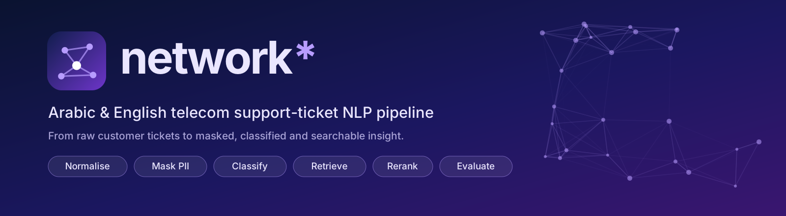
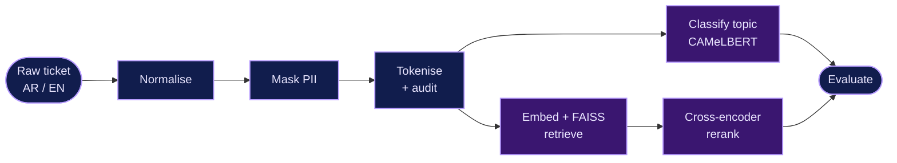
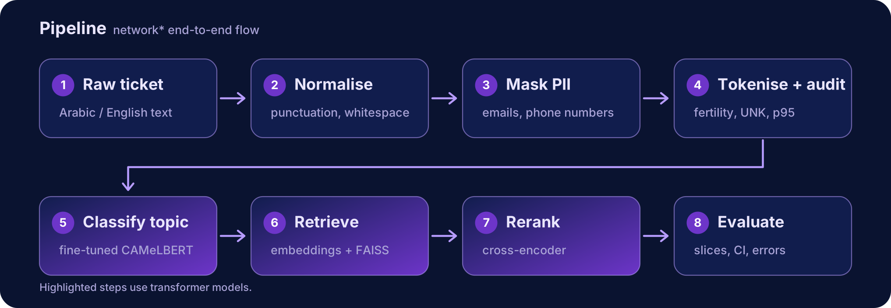
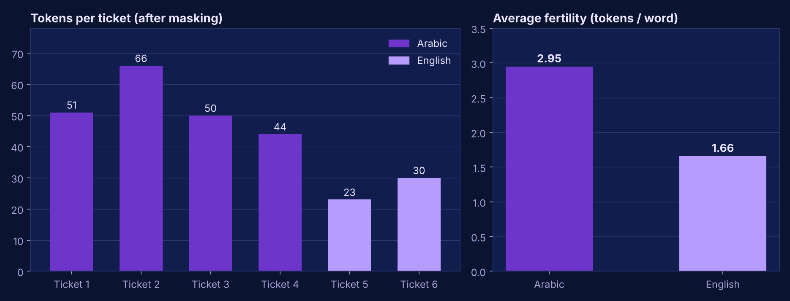
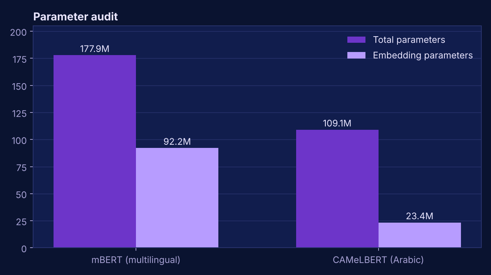
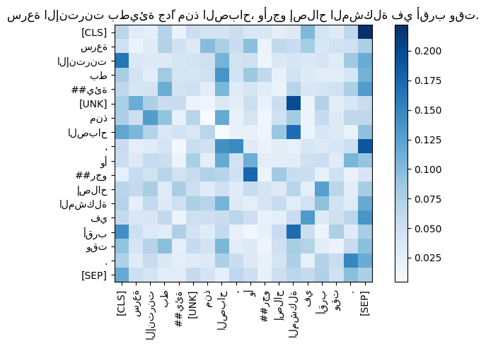

<p align="center">
  
</p>

<p align="center">
  
  
  
  
  
</p>

# network\*

**network\*** is an NLP pipeline for **telecom customer-support tickets** written in **Arabic and English**. It takes a raw ticket and walks it through cleaning, personal-data masking, tokenizer analysis, topic classification, similar-ticket retrieval, reranking and evaluation.

It started as coursework and is organised as a single notebook, with a small interactive demo on top.

> **Demo:** [Open the interactive demo](https://rama-alotaibi1.github.io/Network-Star/) · **Notebook:** [`notebooks/network_pipeline.ipynb`](notebooks/network_pipeline.ipynb)


The demo runs normalisation and PII masking live in the browser using the notebook's rules. Retrieval, reranking and tokenizer results are recorded outputs from the notebook.

---

## Why this project

Telecom support teams receive large volumes of short, noisy, mixed-language tickets. Arabic adds extra difficulty: dialects, diacritics, stretched letters (`الســـرعة`), attached prefixes (`وال`) and heavier tokenization than English. Before any model is useful, the text has to be cleaned, personal data has to be protected, and the tokenizer has to be checked for how well it handles Arabic.

## Pipeline



<p align="center">
  
</p>

## What is in the notebook

| # | Section | What it shows |
|---|---------|---------------|
| 1 | Text preprocessing and tokenizer audit | Normalisation, regex PII masking, tokenization with `distilbert-base-multilingual-cased`, fertility, UNK rate, p95 length |
| 2 | Attention mechanics and model comparison | Scaled dot-product and multi-head attention from scratch, causal mask, attention map, PAD-leak test, mBERT vs CAMeLBERT |
| 3 | Topic classification | Group-aware split by customer, fine-tuning `CAMeL-Lab/bert-base-arabic-camelbert-mix` on five topics |
| 4 | Token alignment for NER | Mapping word-level labels onto subword tokens |
| 5 | Arabic normalisation and segmentation | Letter unification and clitic segmentation |
| 6 | Semantic retrieval and reranking | Sentence embeddings, FAISS index, Recall@10 / MRR@10, cross-encoder reranking |
| 7 | Evaluation and error analysis | Sliced evaluation, bootstrap confidence interval, error review |

## Results and findings

All data in this project is a small hand-written sample, so these numbers show that each step works. They are not benchmark results.

### PII masking

Applied to a sample Arabic ticket (all personal details are fictional):

| Step | Text |
|------|------|
| Original | `أنا سارة الغامدي، هويتي الوطنية 1098765432 والآيبان SA0380000000608010167519 لم يصلني المبلغ المسترجع من الفاتورة راسلوني على test@gmail.com أو 0509876543` |
| Normalised and masked | `أنا سارة الغامدي هويتي الوطنية 1098765432 والآيبان SA0380000000608010167519 لم يصلني المبلغ المسترجع من الفاتورة راسلوني على [EMAIL] أو [PHONE]` |

### Tokenizer audit

<p align="center">
  
</p>

- Arabic tickets average **2.95 tokens per word** versus **1.66** for English, so the same meaning costs Arabic roughly 1.8x more tokens.
- The p95 sequence length is **62.25** tokens and the UNK rate is **0.0** for `distilbert-base-multilingual-cased`.

### Model comparison

<p align="center">
  
</p>

CAMeLBERT is smaller (109.1M vs 177.9M parameters) mainly because its embedding table is far smaller (23.4M vs 92.2M), which comes from an Arabic-focused vocabulary.

### Attention and padding

<p align="center">
  
</p>

- The PAD-leak test shows that attention mass landing on padding tokens is **0.0 with the attention mask** and **about 0.117 without it**, which is why the mask must always be passed.

### Retrieval and reranking

- Searching for `الإنترنت سرعته بطيئة` returns the identical ticket first and a related coverage complaint second.
- For the query `الكهرباء لا تعمل`, the cross-encoder gave the exact-match candidate **4.36** and the unrelated internet-speed tickets about **-3.9** and **-3.7**, so it pushes irrelevant results down.

## Limitations

- **Tiny data.** Classification trains on 6 examples and tests on 4 (evaluation loss about 1.88), so there is no meaningful accuracy figure yet.
- **PII masking is partial.** The regex masks emails and Saudi mobile numbers (`05XXXXXXXX`). National IDs, IBANs and names are **not** masked in the current version.
- **Toy evaluation.** The bootstrap confidence interval in the evaluation section uses an 8-item example, so its range is very wide and changes between runs.
- **Retrieval examples are hand-picked** and are not a benchmark.

## Roadmap

- [ ] Extend PII masking to national IDs, IBANs and names
- [ ] Train and evaluate the classifier on a larger labelled ticket set
- [ ] Add dialect-aware evaluation (Saudi, Egyptian, UAE) with real per-slice scores
- [ ] Serve the full pipeline behind a small API

## Getting started

```bash
git clone https://github.com/YOUR_USERNAME/network-star.git
cd network-star
pip install -r requirements.txt
jupyter notebook notebooks/network_pipeline.ipynb
```

A GPU is not required for the sample data, but it speeds up model loading and training. The first run downloads the Hugging Face models listed below.

## Models used

| Purpose | Model |
|---------|-------|
| Tokenizer audit | `distilbert-base-multilingual-cased` |
| Multilingual baseline | `bert-base-multilingual-cased` |
| Arabic encoder and classifier | `CAMeL-Lab/bert-base-arabic-camelbert-mix` |
| Sentence embeddings | `sentence-transformers/paraphrase-multilingual-MiniLM-L12-v2` |
| Reranking | `cross-encoder/mmarco-mMiniLMv2-L12-H384-v1` |

## Repository structure

```
network-star/
├── README.md
├── requirements.txt
├── notebooks/
│   └── network_pipeline.ipynb
├── docs/
│   └── index.html            # GitHub Pages demo
└── assets/
    ├── banner.png  logo.svg  pipeline.png  demo_screenshot.png
    └── tokenizer_audit.png  parameter_audit.png  attention_map.png
```

## Author

**Rama**, AI specialist based in Riyadh, Saudi Arabia.
This project was developed as part of the Applied Natural Language Processing training program offered by @SDAIAAcademy.

<p align="center"></p>


